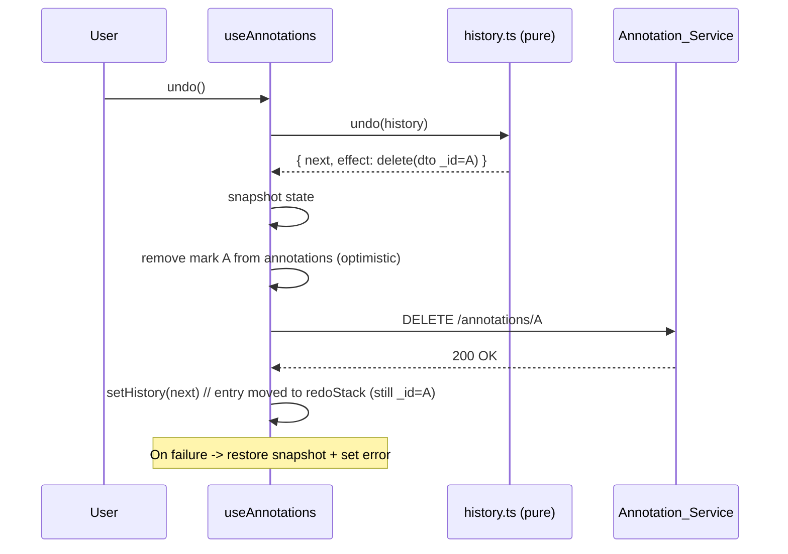
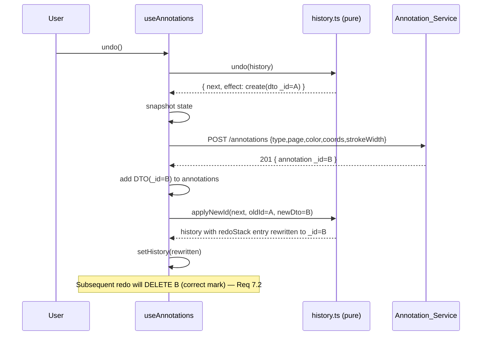

# Design Document: Annotation Undo/Redo

## Overview

This feature adds per-action **undo/redo** to the PDF annotation experience in
the Note-Sphere Viewer (`PDFPreviewModal`). A user annotating a PDF can step
**back** to reverse the most recent annotation action (undo) and step
**forward** to re-apply an action that was just undone (redo). The supported
actions are: create highlight, create scribble, and erase (delete) a mark.

The design deliberately **extends the existing `useAnnotations` hook** rather
than rewriting it. Two guiding decisions shape the whole design:

1. **Separate the pure logic from the I/O.** The undo/redo state machine — two
   stacks and the transitions between them — is pure, deterministic, and highly
   testable. It is extracted into a new pure module `lib/annotations/history.ts`
   (reducer-style functions over an immutable `History` value). The
   `useAnnotations` hook wires persistence (server `POST`/`DELETE`) and React
   state around this pure core.

2. **Record actions at the user gesture, referencing the FINAL server DTO.**
   Creates are optimistic with a temporary `_id` that is reconciled to the
   server-assigned `_id` after the `POST` resolves. To avoid recording a
   history entry that points at a throwaway temp id, the create helpers
   **resolve the reconciled server DTO** and the recorder pushes the action only
   **after the `POST` succeeds**. Erase records the removed server DTO directly.

Because reversing an action re-creates a mark through the server, the server
assigns a **new `_id`** each time. The history therefore treats each stack entry
as carrying the *current* DTO for that mark, and every undo/redo **re-points**
both the moved entry and any correlated entry so subsequent operations target
the correct mark (Requirement 7.2).

This is distinct from the existing **Revert** control (clear-all). Undo/redo
operate on one action at a time and coexist with — and preserve — the existing
create, erase, and Revert behavior and their optimistic-persistence error
semantics.

### Research Notes / Grounding

Key facts drawn from the current code that constrain the design:

- `useAnnotations(noteId)` (`components/modals/useAnnotations.ts`) owns
  `annotations: AnnotationDTO[]`, `loading`, `error`, and exposes
  `createHighlight`, `createScribble`, `deleteOne`, `revertAll`, `byPage`.
- `createHighlight` / `createScribble` build an optimistic `AnnotationDTO` with a
  `tempId()` `_id`, call the internal `persist()` which `POST`s and then
  reconciles the temp record with the server `data.annotation` (which carries the
  real `_id`). Highlight rolls back on failure; scribble is retained on failure.
- `deleteOne(annotationId)` optimistically removes from state, `DELETE`s, and
  restores the snapshot on failure. It is wired to the eraser via
  `onErase={annotations.deleteOne}` in `PDFPreviewModal`.
- `revertAll()` `DELETE`s all annotations for the note and clears local state.
- `AnnotationDTO` (`lib/annotations/serialize.ts`) is the wire/persisted shape:
  `{ _id, noteId, type, pageNumber, color, rects?, points?, strokeWidth?,
  createdAt, updatedAt }`. `serializeAnnotation`/`deserializeAnnotation` are pure
  inverses and preserve coordinate count/order — useful for building a clean
  create payload from a stored DTO.
- `AnnotationToolbar` (`components/modals/AnnotationToolbar.tsx`) already hosts
  tool switch, palette, stroke width, jump-to-page, and Revert (with a confirm
  step) using `lucide-react` icons. Adding Undo/Redo buttons follows the same
  pattern.
- `PDFPreviewModal` constructs `const annotations = useAnnotations(note._id)` and
  passes handlers into `AnnotationToolbar`. Undo/redo plumbing threads through
  the same seam.
- Endpoints are unchanged: `POST /api/notes/:id/annotations` (create) and
  `DELETE /api/notes/:id/annotations/:annotationId` (delete single).

## Architecture

```mermaid
flowchart TD
    User[User gesture: create / erase / undo / redo]
    Toolbar[AnnotationToolbar\n+ Undo / Redo buttons]
    Modal[PDFPreviewModal]
    Hook[useAnnotations hook\n- annotations state\n- undo/redo stacks\n- persistence I/O]
    HistoryMod[lib/annotations/history.ts\nPURE reducer over History]
    Service[Annotation_Service\nPOST / DELETE endpoints]

    User -->|create/erase on canvas| Modal
    User -->|Undo/Redo click| Toolbar
    Toolbar --> Modal
    Modal -->|createHighlight/createScribble/deleteOne/undo/redo| Hook
    Hook -->|recordAction / undo / redo / clearRedo / clear| HistoryMod
    HistoryMod -->|next History + effect descriptor| Hook
    Hook -->|POST / DELETE| Service
    Service -->|server DTO w/ new _id| Hook
    Hook -->|canUndo / canRedo / undo() / redo() + existing API| Modal
    Modal --> Toolbar
```

**Layering:**

- **Pure layer (`lib/annotations/history.ts`)**: owns the `History` value (both
  stacks) and the transition rules. Given a `History` and an action, it returns
  the next `History` plus a **descriptor of the side effect** the hook must
  perform (delete this DTO, or re-create this DTO). It never performs I/O and
  never reads the clock or network. This is the property-tested core.
- **Wiring layer (`useAnnotations`)**: holds the `History` in React state (mirror
  in a `ref` to avoid stale closures, matching the existing `annotationsRef`
  pattern), executes the side effects described by the pure layer against the
  `Annotation_Service`, reconciles new server `_id`s back into the pure layer,
  and manages optimistic rollback + the shared `error` string.
- **Presentation layer (`AnnotationToolbar` / `PDFPreviewModal`)**: renders Undo
  and Redo controls bound to `canUndo`/`canRedo` and calls `undo()`/`redo()`.

### Why a "describe effect, then execute" split

The pure module cannot call `fetch`. But undo/redo require I/O (a `POST` returns
a *new* `_id` that must flow back into both stacks). So the pure `undo`/`redo`
functions return the *intended* next `History` **and** an `Effect` describing
what the wiring layer must persist. The wiring layer performs the effect, and —
for re-creations that yield a new `_id` — calls a small pure helper
(`applyNewId`) to rewrite the moved entry (and any correlated opposite-stack
entry) with the server DTO. This keeps all branching logic pure and testable
while confining `fetch` and reconciliation to the hook.

## Components and Interfaces

### 1. `lib/annotations/history.ts` (new, pure)

The testable core. No React, no `fetch`.

```ts
import type { AnnotationDTO } from "@/lib/annotations/serialize";

/** A single reversible annotation operation. The `annotation` field always
 *  holds the CURRENT server DTO for the mark (its `_id` may be rewritten after
 *  a re-creation assigns a new id). */
export type UndoableAction =
  | { kind: "create"; annotation: AnnotationDTO }
  | { kind: "erase"; annotation: AnnotationDTO };

/** Immutable undo/redo state. Top of each stack is the LAST element. */
export interface History {
  undoStack: UndoableAction[];
  redoStack: UndoableAction[];
}

/** Side effect the wiring layer must perform to realize a transition. */
export type Effect =
  | { op: "delete"; annotation: AnnotationDTO } // remove this mark via DELETE
  | { op: "create"; annotation: AnnotationDTO } // re-create this mark via POST
  | { op: "none" }; // empty-stack no-op

/** Result of a pure transition: the next history plus the effect to run. */
export interface Transition {
  history: History;
  effect: Effect;
}

export const emptyHistory: History = { undoStack: [], redoStack: [] };

/** Req 1.1-1.4, Req 4: record a freshly performed user action.
 *  Appends to undoStack and clears redoStack. */
export function recordAction(h: History, action: UndoableAction): History;

/** Req 2: compute the undo transition (does NOT run I/O).
 *  - create at top  -> effect delete(annotation); move entry to redoStack
 *  - erase  at top  -> effect create(annotation); move entry to redoStack
 *  - empty          -> effect none; history unchanged (Req 2.4) */
export function undo(h: History): Transition;

/** Req 3: compute the redo transition (does NOT run I/O).
 *  - create at top of redo -> effect create(annotation); move to undoStack
 *  - erase  at top of redo -> effect delete(annotation); move to undoStack
 *  - empty                 -> effect none; history unchanged (Req 3.4) */
export function redo(h: History): Transition;

/** Req 4.1: clear only the redo stack. */
export function clearRedo(h: History): History;

/** Req 1.5 / Req 8.3: clear both stacks (session end, revert). */
export function clear(): History;

/** Req 7.2: after a re-creation assigns a NEW server _id, rewrite the entry
 *  that was just moved (identified by its previous DTO `_id`) AND any correlated
 *  entry on either stack that still references the old `_id`, so later
 *  operations target the right mark. Returns a new History. */
export function applyNewId(
  h: History,
  oldId: string,
  newDto: AnnotationDTO
): History;
```

Notes on the pure module:

- All functions are **total** and **immutable** (return new arrays/objects).
- `undo`/`redo` on an empty stack return `{ history: h, effect: { op: "none" } }`
  — the wiring layer treats `none` as "do nothing", satisfying the no-op
  requirements (2.4, 3.4).
- `applyNewId` is the single place that implements the `_id` re-pointing rule
  (7.2); both the hook's undo and redo paths call it after a successful `POST`.

### 2. `useAnnotations` hook (extended, not rewritten)

New internal state, mirroring the existing `annotationsRef` pattern:

```ts
const [history, setHistory] = useState<History>(emptyHistory);
const historyRef = useRef<History>(emptyHistory);
historyRef.current = history;
```

Extended public interface (existing members unchanged):

```ts
export interface UseAnnotations {
  // --- existing (unchanged) ---
  annotations: AnnotationDTO[];
  byPage: (page: number) => AnnotationDTO[];
  loading: boolean;
  error: string | null;
  createHighlight: (page: number, rects: NormRect[], color: PaletteColor) => Promise<void>;
  createScribble: (page: number, points: NormPoint[], color: PaletteColor, strokeWidth: number) => Promise<void>;
  deleteOne: (annotationId: string) => Promise<void>;
  revertAll: () => Promise<void>;

  // --- new ---
  canUndo: boolean; // history.undoStack.length > 0
  canRedo: boolean; // history.redoStack.length > 0
  undo: () => Promise<void>;
  redo: () => Promise<void>;
}
```

**Recording on create (approach (a) — push after POST resolves):**

- `persist()` is refactored to **return the reconciled server DTO** (or `null`
  on rollback/failure). The existing optimistic render + reconcile + error
  behavior is unchanged.
- `createHighlight` / `createScribble` `await persist(...)`; **iff** a server DTO
  is returned, they call `setHistory((h) => recordAction(h, { kind: "create",
  annotation: serverDto }))`. This guarantees the history entry references the
  FINAL server `_id`, and a failed/rolled-back create records nothing
  (consistency with Req 6 / Req 8.1). Recording also clears the redo stack
  (Req 4, via `recordAction`).

**Recording on erase:**

- The eraser path needs the full DTO (not just the id) to be able to restore it
  on undo. `deleteOne(annotationId)` looks up the DTO in `annotationsRef.current`
  **before** optimistic removal, performs the existing optimistic delete, and —
  on success — calls `setHistory((h) => recordAction(h, { kind: "erase",
  annotation: removedDto }))`. On failure it restores state and records nothing.
  (The eraser continues to call `deleteOne`; no signature change is required for
  callers, since the DTO is resolved internally from the id.)

**`undo()` (wiring around pure `undo`):**

1. Snapshot `{ annotations, history }` for rollback (Req 6.1).
2. `const { history: next, effect } = undo(historyRef.current)`.
3. If `effect.op === "none"` → return (empty-stack no-op, Req 2.4).
4. Apply the visual change optimistically and persist:
   - `effect.op === "delete"` (undoing a create): remove the mark from
     `annotations`; `DELETE /api/notes/:id/annotations/:_id`. Set
     `setHistory(next)`.
   - `effect.op === "create"` (undoing an erase): `POST` the mark rebuilt from
     the stored DTO; on success add the returned server DTO to `annotations`,
     then `setHistory(applyNewId(next, oldId, serverDto))` so the entry now on
     the redo stack references the new `_id` (Req 7.2).
5. On any persistence failure: restore the snapshot (annotations + history) and
   set the shared `error` string (Req 6.1, 6.3).

**`redo()` (wiring around pure `redo`)** is the mirror image:

- Undone **create** → `POST` (new `_id`); add to `annotations`; move entry to
  undo stack; `applyNewId` to re-point (Req 3.1, 3.3, 7.2).
- Undone **erase** → `DELETE`; remove from `annotations`; move entry to undo
  stack (Req 3.2, 3.3).
- Empty redo stack → no-op (Req 3.4). Failure → restore snapshot + error
  (Req 6.2, 6.3).

**Revert integration:** `revertAll()` additionally calls `setHistory(clear())`
on success so both stacks are dropped (Req 8.3). The clear-all network behavior
is unchanged (Req 8.2).

**Payload construction for re-creation:** to rebuild a `POST` body from a stored
DTO, the hook reuses the existing `persist` body shape (`type, pageNumber,
color, rects, points, strokeWidth`). The stored DTO already carries these fields;
`deserializeAnnotation`/`serializeAnnotation` may be used to normalize
coordinate arrays, guaranteeing type/page/coords/color/strokeWidth are preserved
(Req 7.1).

### 3. `AnnotationToolbar` (extended)

New props and controls:

```ts
export interface AnnotationToolbarProps {
  // ... existing props ...
  onUndo: () => void;
  onRedo: () => void;
  canUndo: boolean;
  canRedo: boolean;
}
```

- Add two buttons using `lucide-react` `Undo2` and `Redo2` icons, placed next to
  the Revert control.
- `Undo` button: `disabled={!canUndo}`, `onClick={onUndo}`, `aria-label="Undo"`.
- `Redo` button: `disabled={!canRedo}`, `onClick={onRedo}`, `aria-label="Redo"`.
- Disabled styling reuses the existing `disabled:opacity-30` pattern used by the
  page-navigation buttons, keeping the visual language consistent (Req 5.2-5.5).

### 4. `PDFPreviewModal` (extended)

Pass the new hook members into the toolbar:

```tsx
<AnnotationToolbar
  /* ...existing props... */
  onUndo={annotations.undo}
  onRedo={annotations.redo}
  canUndo={annotations.canUndo}
  canRedo={annotations.canRedo}
/>
```

No other modal changes are required; error display already renders
`annotations.error`.

## Data Models

### `UndoableAction`

```ts
type UndoableAction =
  | { kind: "create"; annotation: AnnotationDTO }
  | { kind: "erase"; annotation: AnnotationDTO };
```

- `kind: "create"` — the user added a mark. `annotation` is the **server DTO**
  (final `_id`). Undo deletes it; redo re-creates it (new `_id`).
- `kind: "erase"` — the user erased a mark. `annotation` is the DTO captured at
  erase time (type, page, color, coords, strokeWidth). Undo re-creates it (new
  `_id`); redo deletes it.

### `History`

```ts
interface History {
  undoStack: UndoableAction[]; // performed actions, top = last element
  redoStack: UndoableAction[]; // undone actions, top = last element
}
```

Invariants maintained by the pure module:

- Ordering reflects performance order within the session (Req 1.4).
- `recordAction` always empties `redoStack` (Req 4).
- Each entry's `annotation._id` equals the id of the mark currently
  representing that action after the latest re-creation (Req 7.2).

### `AnnotationDTO` (existing, reused unchanged)

`{ _id, noteId, type, pageNumber, color, rects?, points?, strokeWidth?,
createdAt, updatedAt }` — the same shape produced by the create endpoint and
stored in `annotations`.

## Undo/Redo sequences (with `_id` re-pointing)

### Undo a create



### Undo an erase (re-create assigns NEW id)



`redo` mirrors these: re-applying an undone create `POST`s (new id, re-point via
`applyNewId`), re-applying an undone erase `DELETE`s.


## Correctness Properties

*A property is a characteristic or behavior that should hold true across all
valid executions of a system — essentially, a formal statement about what the
system should do. Properties serve as the bridge between human-readable
specifications and machine-verifiable correctness guarantees.*

These properties target the pure `lib/annotations/history.ts` module, where the
undo/redo logic lives independently of I/O. Each property is universally
quantified and should be validated with a property-based test (minimum 100
iterations) over randomly generated `History` values and `AnnotationDTO`s.

### Property 1: Recording an action appends it to the undo stack in order

*For any* `History` and *any* sequence of `UndoableAction`s, folding
`recordAction` over the sequence produces a `History` whose `undoStack` equals
that sequence appended (in performance order) to the original `undoStack`, and
whose top entry is the most recently recorded action.

**Validates: Requirements 1.1, 1.2, 1.4, 4.2**

### Property 2: Recording a new action clears the redo stack

*For any* `History` and *any* `UndoableAction`, `recordAction(history, action)`
produces a `History` whose `redoStack` is empty.

**Validates: Requirements 4.1**

### Property 3: Undo produces the correct effect and moves the top entry

*For any* `History` whose `undoStack` is non-empty, `undo(history)` moves the top
`undoStack` entry to the top of the `redoStack` (undoStack shrinks by one,
redoStack grows by one), and returns an `Effect` that is `delete(annotation)`
when the entry `kind` is `"create"` and `create(annotation)` when the entry
`kind` is `"erase"`.

**Validates: Requirements 2.1, 2.2, 2.3**

### Property 4: Redo produces the correct effect and moves the top entry

*For any* `History` whose `redoStack` is non-empty, `redo(history)` moves the top
`redoStack` entry to the top of the `undoStack` (redoStack shrinks by one,
undoStack grows by one), and returns an `Effect` that is `create(annotation)`
when the entry `kind` is `"create"` and `delete(annotation)` when the entry
`kind` is `"erase"`.

**Validates: Requirements 3.1, 3.2, 3.3**

### Property 5: Undo and redo are inverse operations (round-trip)

*For any* `History` whose `undoStack` is non-empty, applying `undo` and then
`redo` (re-pointing ids as the wiring layer would after a re-creation) yields a
`History` structurally equal to the original — the same action `kind`s and mark
fields in the same stack positions. Symmetrically, *for any* `History` whose
`redoStack` is non-empty, applying `redo` then `undo` restores the original
structure.

**Validates: Requirements 2.1, 2.2, 2.3, 3.1, 3.2, 3.3**

### Property 6: Undo and redo on an empty stack are no-ops

*For any* `History` whose `undoStack` is empty, `undo(history)` returns the same
`History` and an `Effect` of `none`. *For any* `History` whose `redoStack` is
empty, `redo(history)` returns the same `History` and an `Effect` of `none`.

**Validates: Requirements 2.4, 3.4**

### Property 7: Applying a new id re-points every reference to the old id

*For any* `History`, *any* `oldId` present in the history, and *any* replacement
`AnnotationDTO` carrying a new `_id`, after `applyNewId(history, oldId, newDto)`
no entry on either stack references `oldId`, and every entry that previously
referenced `oldId` now references `newDto._id` with `newDto`'s fields.

**Validates: Requirements 7.2**

### Property 8: A re-created mark preserves all mark fields

*For any* `AnnotationDTO` stored in an `UndoableAction`, the create payload
rebuilt from that action preserves the mark's `type`, `pageNumber`, `color`,
normalized coordinates (`rects`/`points` with identical count and order), and
`strokeWidth`.

**Validates: Requirements 1.3, 7.1**

### Property 9: Clear empties both stacks

*For any* `History`, `clear()` returns a `History` whose `undoStack` and
`redoStack` are both empty.

**Validates: Requirements 1.5, 8.3**

## Error Handling

Undo/redo reuse the established optimistic-persistence pattern already present in
`useAnnotations` (snapshot → optimistic mutate → persist → rollback on failure).

- **Snapshot before mutating.** Each of `undo()`/`redo()` captures a snapshot of
  both `annotations` and the current `History` (via `annotationsRef`/
  `historyRef`) before any optimistic change.
- **Undo persistence failure (Req 6.1).** If the `DELETE` (undoing a create) or
  `POST` (undoing an erase) rejects or returns non-OK, restore the annotations
  snapshot **and** the history snapshot, then set the shared `error` string.
- **Redo persistence failure (Req 6.2).** Mirror behavior: restore both
  snapshots and set `error`.
- **Consistent error surface (Req 6.3).** Failures set the same `error` string
  the hook already exposes; `PDFPreviewModal` already renders `annotations.error`
  in the toolbar's alert region — no new UI surface is added.
- **Empty-stack no-ops (Req 2.4, 3.4).** When the pure layer returns
  `effect: none`, the hook performs no network call and no state change.
- **Create-record only on success.** Because create history entries are pushed
  only after the `POST` resolves with a server DTO, a failed create (highlight
  rollback / scribble retained-with-error) never leaves a dangling history entry
  pointing at a temp id.
- **New-id reconciliation failure.** If a re-creation `POST` succeeds but returns
  a malformed DTO (no `_id`), treat it as a failure: restore snapshots and set
  `error`, so the stacks never hold an entry with an unusable reference.

## Testing Strategy

A dual approach: **property-based tests** for the pure history reducer and
**component/integration tests** (with mocked `fetch`) for the wiring and UI.

### Property-based tests (pure `lib/annotations/history.ts`)

- Use **fast-check** (the standard property-based testing library for
  TypeScript/JavaScript) with the existing test runner. Do **not** hand-roll a
  PBT harness.
- Provide generators (arbitraries) for `AnnotationDTO` (both `highlight` with
  `rects` and `scribble` with `points`+`strokeWidth`), `UndoableAction`, and
  `History` (including empty stacks and histories that share ids across stacks).
- Implement each Correctness Property (1–9) as a **single** property-based test,
  configured for a **minimum of 100 iterations**.
- Tag each test with a comment referencing its design property, format:
  `// Feature: annotation-undo-redo, Property {number}: {property_text}`.

### Unit / example tests

- `clear()` returns `emptyHistory` (Req 1.5, 8.3 example-level).
- `undo`/`redo` on `emptyHistory` return `effect: none` and unchanged history
  (explicit boundary examples backing Property 6).
- Payload rebuilt from a stored erase DTO equals the original mark fields
  (concrete example backing Property 8), including a scribble with `strokeWidth`
  and a highlight with multiple `rects`.

### Component tests (`AnnotationToolbar`)

- Renders both an Undo and a Redo control (Req 5.1).
- `canUndo=false` → Undo disabled; `canUndo=true` → Undo enabled (Req 5.2, 5.3).
- `canRedo=false` → Redo disabled; `canRedo=true` → Redo enabled (Req 5.4, 5.5).
- Clicking the enabled Undo calls `onUndo`; clicking enabled Redo calls `onRedo`
  (Req 5.6, 5.7).
- Disabled controls do not invoke their handlers.

### Integration tests (`useAnnotations`, mocked `fetch`)

- Undo of a create issues a `DELETE` for the correct `_id`; undo of an erase
  issues a `POST` and adds the returned DTO (Req 2.1, 2.2, 2.5).
- Redo of an undone create issues a `POST` (new `_id`) and re-points the entry;
  redo of an undone erase issues a `DELETE` (Req 3.1, 3.2, 3.5, 7.2).
- On a rejected `fetch` during undo/redo, `annotations` and both stacks return to
  the pre-operation snapshot and `error` is set (Req 6.1, 6.2, 6.3).
- Create records a history entry only after the `POST` resolves with the server
  DTO; a failed create records nothing (Req 8.1).
- `revertAll` success clears both stacks (Req 8.3); create/erase optimistic
  behavior is unchanged (Req 8.1).

### Notes on scope

- **Req 7.3 (owner/note scoping)** is enforced by the existing owner-scoped
  endpoints and the `noteId` already threaded through the hook; no new logic is
  introduced, so it is covered by existing endpoint behavior rather than a new
  property.
- **Req 1.5 (session end)** discards in-memory state naturally on hook unmount;
  the pure `clear()` covers the resettable portion.
- Property-based testing is intentionally confined to the pure reducer, where
  behavior varies meaningfully with input; I/O paths use mocked example-based
  tests because their behavior does not vary meaningfully across 100 iterations.
