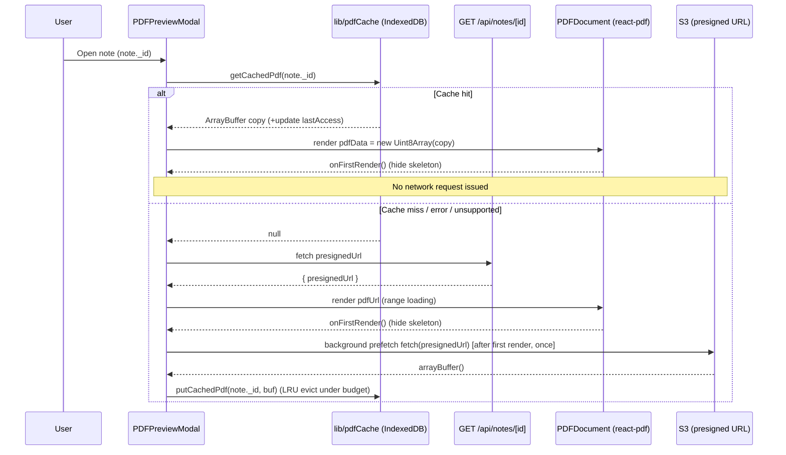

# Design Document: instant-pdf-loading

## Overview

This design adds a **persistent client-side PDF byte cache** (IndexedDB) plus a
**non-blocking background prefetch** and a **loading skeleton** to the existing
`PDFPreviewModal` / `PDFDocument` Viewer. The goal is near-instant repeat opens
of the same note's PDF, with no server or infrastructure changes and no loss of
render quality.

The design is strictly **additive and low-risk**. The existing
`Network_Load_Path` (presigned URL from `GET /api/notes/[id]` + `react-pdf` HTTP
range loading) remains the **guaranteed fallback**. Every cache operation is
best-effort: any failure, unsupported environment, or SSR condition returns
`null`/no-op and the Viewer proceeds exactly as it does today. Caching is a pure
enhancement layered on top of an unchanged network path.

### Key design decisions

| Decision | Rationale |
| --- | --- |
| Store full PDF bytes in IndexedDB keyed by `note._id` | Survives reloads/tabs; large binary storage suited to IndexedDB, not `localStorage`. |
| Cache-first read, then fall back to URL | Instant repeat open; network path stays authoritative when cache misses or errors. |
| Prefetch only after first page renders, only on URL loads | First-open latency is unchanged; the full file is warmed for next time. |
| Copy-on-read and copy-on-write of `ArrayBuffer` | pdf.js may transfer/detach the buffer to its worker; copies prevent detached-buffer corruption. |
| LRU eviction under a fixed byte budget | Bounded storage without unbounded growth. |
| All `pdfCache` ops wrapped in `try/catch` returning `null`/no-op | The cache can never break the guaranteed URL fallback. |

## Architecture

```
PDFPreviewModal (open, keyed by note._id)
        │
        ├── 1. getCachedPdf(note._id) ──► lib/pdfCache.ts ──► IndexedDB "notesphere-pdf-cache"
        │        hit → setPdfBytes(fresh Uint8Array copy)  (skip network entirely)
        │        miss/error/unsupported → null
        │
        ├── 2. (on miss) fetch GET /api/notes/[id] → presignedUrl → setPdfUrl
        │
        ├── 3. render <PDFDocument pdfData? | pdfUrl>  (Render_Settings unchanged)
        │        first page onRenderSuccess → onFirstRender() → hide skeleton
        │
        └── 4. (URL loads only, once) background prefetch:
                 fetch(presignedUrl) → arrayBuffer() → putCachedPdf(note._id, buf)
                 (LRU eviction under CACHE_BUDGET; non-blocking; best-effort)
```

New/changed modules:

- **`lib/pdfCache.ts`** (new): client-only IndexedDB byte cache with a small,
  fully `try/catch`-guarded async API.
- **`components/modals/PDFPreviewModal.tsx`** (changed): cache-first open,
  background prefetch, skeleton state, passes `pdfData` to `PDFDocument`.
- **`components/modals/PDFDocument.tsx`** (changed): accepts optional
  `pdfData`, memoizes the `react-pdf` `file` object, adds `onFirstRender`
  callback; URL path unchanged.

### Sequence: cache-hit vs cache-miss + prefetch



## Components and Interfaces

### 1. `lib/pdfCache.ts` (new, client-only, best-effort)

All functions are safe to call in any environment. On SSR, when IndexedDB is
unavailable, or on any thrown error, reads resolve to `null` and writes resolve
to a no-op. **No function ever rejects/throws to its caller.**

```ts
// lib/pdfCache.ts
// IndexedDB-backed, best-effort PDF byte cache. All ops are wrapped in
// try/catch; failures return null (reads) or no-op (writes). Never throws.

const DB_NAME = "notesphere-pdf-cache";
const DB_VERSION = 1;
const STORE = "pdfs"; // keyPath: "id" (noteId)
export const CACHE_BUDGET = 150 * 1024 * 1024; // 150 MB total across all entries

// Stored record shape (see Data Models).
export interface PdfCacheRecord {
  id: string;          // Cache_Key = note._id
  bytes: ArrayBuffer;  // complete PDF file bytes
  size: number;        // bytes.byteLength (denormalized for eviction math)
  lastAccess: number;  // Date.now() of last read/write (LRU key)
}

// Lazily open the DB. Returns null on SSR/unsupported/error.
export function openDb(): Promise<IDBDatabase | null>;

// Return a COPY of the cached bytes (bytes.slice(0)) and update lastAccess.
// Returns null on miss or any error.
export function getCachedPdf(noteId: string): Promise<ArrayBuffer | null>;

// Store a COPY of bytes; enforce CACHE_BUDGET via LRU eviction.
// If a single file > CACHE_BUDGET, skip storing. Swallows all errors.
export function putCachedPdf(noteId: string, bytes: ArrayBuffer): Promise<void>;
```

Internal helpers (not exported):

- `withStore(mode, fn)`: opens the DB, runs a transaction, resolves `null`/no-op
  on any error — the single choke point that guarantees best-effort behavior.
- `evictToBudget(store, incomingSize)`: reads all records' `{id, size, lastAccess}`,
  sorts by `lastAccess` ascending (oldest first), and deletes entries until
  `totalStored + incomingSize <= CACHE_BUDGET`. Removes each entry's full record
  (bytes + metadata together, since metadata lives on the record).
- **In-memory duplicate-prefetch guard**: a module-level
  `Set<string>` (`inFlightPrefetch`) so concurrent prefetches for the same
  `noteId` are deduped. `getCachedPdf`/`putCachedPdf` also treat writes as
  idempotent (overwrite by key).

Behavioral notes:

- `getCachedPdf` returns `bytes.slice(0)` (a detached-safe **copy**), never the
  stored buffer instance. It updates `lastAccess` on the stored record in the
  same or a follow-up transaction (best-effort; a failed `lastAccess` update
  does not fail the read).
- `putCachedPdf` stores `bytes.slice(0)` (a copy) so the caller's buffer is never
  retained/aliased. Copy-on-write + copy-on-read together guarantee the stored
  bytes are independent of any buffer pdf.js may later detach.
- `CACHE_BUDGET = 150 MB`. If `bytes.byteLength > CACHE_BUDGET`, skip (Req 3.3).

### 2. `PDFPreviewModal.tsx` (changed)

New state:

```ts
const [pdfBytes, setPdfBytes] = useState<Uint8Array | null>(null); // cache-hit render source
const [firstPageRendered, setFirstPageRendered] = useState(false); // controls skeleton
const prefetchedRef = useRef(false);                               // prefetch runs once
// existing: pdfUrl, numPages, currentPage, scale, isLoading, error, ...
```

Open effect (keyed by `note._id`) — cache-first:

```ts
useEffect(() => {
  let cancelled = false;
  setFirstPageRendered(false);
  prefetchedRef.current = false;

  (async () => {
    // (a) cache-first: try IndexedDB before any network request
    const cached = await getCachedPdf(note._id); // best-effort, may be null
    if (cancelled) return;
    if (cached) {
      setPdfBytes(new Uint8Array(cached)); // FRESH copy handed to pdf.js
      setIsLoading(false);
      return; // skip presigned URL fetch entirely (Req 1.2)
    }
    // (b) miss/error → existing Network_Load_Path
    if (externalUrl) { setPdfUrl(externalUrl); setIsLoading(false); return; }
    try {
      const res = await fetch(`/api/notes/${note._id}`);
      const data = await res.json();
      if (!res.ok) throw new Error(data.error);
      if (!cancelled) setPdfUrl(data.presignedUrl);
    } catch {
      if (!cancelled) setError("Failed to load PDF. Please try again.");
    } finally {
      if (!cancelled) setIsLoading(false);
    }
  })();

  return () => { cancelled = true; };
}, [note._id, externalUrl]);
```

Background prefetch (triggered from `onDocumentLoadSuccess`, i.e. after first
page load, URL-loads only, once):

```ts
async function maybePrefetch() {
  if (prefetchedRef.current) return;      // once only
  if (pdfBytes) return;                    // loaded from cache → nothing to prefetch
  const src = externalUrl || pdfUrl;
  if (!src) return;
  prefetchedRef.current = true;
  try {
    const buf = await fetch(src).then((r) => r.arrayBuffer());
    await putCachedPdf(note._id, buf);     // best-effort LRU store
  } catch {
    /* non-fatal: cache stays unchanged, URL path keeps rendering (Req 2.5) */
  }
}
```

Render source selection: pass `pdfData={pdfBytes ?? undefined}` and
`pdfUrl={pdfUrl ?? undefined}` to `PDFDocument`, plus
`onFirstRender={() => setFirstPageRendered(true)}`. The annotation toolbar
gating changes from `pdfUrl && !error` to `(pdfUrl || pdfBytes) && !error`.

Skeleton: while `!firstPageRendered && !error`, render an animated skeleton sized
to the page area (see Loading Placeholder below) instead of the blank white box.
The existing spinner/error UI is preserved.

### 3. `PDFDocument.tsx` (changed)

Prop additions (all optional, existing callers unaffected):

```ts
interface PDFDocumentProps {
  pdfUrl?: string;             // now optional
  pdfData?: Uint8Array;        // NEW: in-memory bytes for cache-hit render
  onFirstRender?: () => void;  // NEW: fired once from Page onRenderSuccess
  // ...all existing props unchanged (currentPage, scale, containerWidth,
  //    onLoadSuccess, onLoadError, annotation props, dims, etc.)
}
```

Memoized `file` object (stable identity prevents react-pdf reloads):

```ts
const file = useMemo(
  () => (pdfData ? { data: pdfData } : pdfUrl ? { url: pdfUrl } : null),
  [pdfData, pdfUrl]
);
```

- **Detached-buffer safety (critical):** pdf.js may transfer/detach the `data`
  `ArrayBuffer` to its worker. The modal MUST pass a **fresh** `new Uint8Array(cachedCopy)`
  and never reuse that exact instance elsewhere; `pdfCache` always hands out
  copies. `PDFDocument` treats `pdfData` as owned by pdf.js once passed.
- Render guard: if `file` is `null` (neither source available), render nothing
  (return `null`) — the modal shows the skeleton/spinner instead.
- `onFirstRender`: called from the page `onRenderSuccess` handler **after**
  reporting dimensions (`onPageDimensions`), so the modal hides the skeleton
  exactly when the first page is painted.
- **Unchanged:** `PDF_OPTIONS`, `renderDpr`/`deviceDpr`/`QUALITY` supersampling,
  `pageWidth`/`fitWidth`/`overlayScale` fit-to-width math, `renderTextLayer`,
  annotation overlay, worker setup. Cache-hit and URL renders share identical
  `Render_Settings`.

## Data Models

### IndexedDB schema

- **Database:** `notesphere-pdf-cache`, version `1`.
- **Object store:** `pdfs`, `keyPath: "id"` (no autoIncrement). One record per
  note; the key is the `Cache_Key` (`note._id`), giving a strict 1:1 mapping
  between key and stored bytes (Req 6.2).
- **Record (`PdfCacheRecord`):**

  | Field | Type | Meaning |
  | --- | --- | --- |
  | `id` | `string` | `Cache_Key` = `note._id` |
  | `bytes` | `ArrayBuffer` | Complete PDF file bytes (a copy) |
  | `size` | `number` | `bytes.byteLength`, denormalized for eviction math |
  | `lastAccess` | `number` | `Date.now()` at last read/write (LRU ordering key) |

  LRU metadata (`lastAccess`, `size`) lives **on the record**, so deleting a
  record removes bytes and metadata atomically (Req 3.4). No separate `meta`
  store is required; the "meta concept" is satisfied by these per-record fields.

- **Budget constant:** `CACHE_BUDGET = 150 * 1024 * 1024` (150 MB) total across
  all entries (Req 3.1).


## Correctness Properties

*A property is a characteristic or behavior that should hold true across all valid
executions of a system — a formal statement about what the system should do.
Properties bridge human-readable specifications and machine-verifiable guarantees.*

These properties target the pure, input-varying logic of `lib/pdfCache.ts` and the
source-independence of `PDFDocument` rendering. Timing, UI feel, wiring order, and
documentation criteria are covered by unit/component/integration tests instead
(see Testing Strategy).

### Property 1: Put/get round-trip with key association

*For any* set of distinct `(Cache_Key, bytes)` pairs whose sizes each fit within
`CACHE_BUDGET`, after `putCachedPdf(k, bytes)` for each pair, `getCachedPdf(k)`
returns content byte-equal to the bytes stored under `k`, and never returns bytes
stored under any other key.

**Validates: Requirements 2.3, 6.1, 6.2**

### Property 2: Copy-on-read/write prevents shared-buffer detachment

*For any* `bytes` stored via `putCachedPdf`, the buffer returned by a subsequent
`getCachedPdf` is a distinct `ArrayBuffer` instance from both the caller's input
buffer and the internally stored buffer; mutating or detaching any one returned
copy leaves the stored bytes and other reads byte-equal to the original.

**Validates: Requirements 1.2, 2.3**

### Property 3: Cache stays within budget

*For any* sequence of `putCachedPdf` operations (arbitrary keys and sizes), after
each operation the sum of `size` over all stored records is less than or equal to
`CACHE_BUDGET`; and if an incoming file's size exceeds `CACHE_BUDGET`, the stored
record set is left unchanged.

**Validates: Requirements 3.1, 3.3**

### Property 4: LRU eviction removes oldest-accessed first

*For any* set of stored records with distinct `lastAccess` values and an incoming
put that would exceed `CACHE_BUDGET`, the entries removed are exactly those with
the oldest `lastAccess` needed to fit the incoming bytes; no record is evicted
while a strictly older-accessed record survives, and each removed record's bytes
and metadata are removed together (a subsequent `getCachedPdf` for an evicted key
returns `null`).

**Validates: Requirements 3.2, 3.4**

### Property 5: Reading refreshes last-access

*For any* stored record, calling `getCachedPdf(k)` results in that record's
`lastAccess` being greater than or equal to its value before the read (and no
smaller than any pre-read value), while the `lastAccess` of records not read is
left unchanged.

**Validates: Requirements 1.3**

### Property 6: Cache operations are best-effort and never break the URL fallback

*For any* injected failure condition at open, read, or write (thrown error,
unsupported environment, or SSR), `getCachedPdf` resolves to `null` and
`putCachedPdf` resolves without effect — neither ever rejects or throws — so the
Viewer always reaches the Network_Load_Path and renders.

**Validates: Requirements 1.4**

### Property 7: Render settings are source-independent

*For any* `(containerWidth, scale, unscaledWidth, unscaledHeight)`, the computed
`pageWidth`, `overlayScale`, and `renderDpr` in `PDFDocument` are identical whether
the document is provided via `pdfData` (cache) or `pdfUrl` (network), and
`renderTextLayer` / annotation configuration are identical for both sources.

**Validates: Requirements 4.1, 4.3**

### Property 8: Loading placeholder shown until first render for both sources

*For any* render source (`pdfData` or `pdfUrl`), while `firstPageRendered` is
false and no error has occurred, the Viewer displays the Loading_Placeholder;
once `onFirstRender` fires, the placeholder is removed.

**Validates: Requirements 5.4, 5.1, 5.2**

## Error Handling

- **All cache operations are best-effort (never throw).** `openDb`,
  `getCachedPdf`, and `putCachedPdf` wrap every IndexedDB interaction
  (`open`, `onerror`, `onblocked`, transaction abort, quota exceeded, structured
  clone failure) in `try/catch`. Reads resolve `null`; writes resolve to a no-op.
  This is the guaranteed-fallback contract (Req 1.4) — a failing cache degrades to
  the unchanged Network_Load_Path.
- **SSR / unsupported environments.** `openDb` returns `null` when
  `typeof indexedDB === "undefined"` (server render or unsupported browser), so
  the modal silently uses the URL path.
- **Prefetch failure is non-fatal.** A rejected `fetch(presignedUrl)` or
  `arrayBuffer()` is caught in `maybePrefetch`; the cache is left unchanged and the
  page continues rendering via range loading (Req 2.5). The `prefetchedRef` guard
  still marks the attempt so it does not retry-loop.
- **Detached-buffer avoidance.** pdf.js may transfer/detach the `data`
  `ArrayBuffer` to its worker. Mitigations: (1) the cache stores a copy
  (`bytes.slice(0)`) and returns a copy on read; (2) the modal wraps each read in
  a **fresh** `new Uint8Array(cachedCopy)` before handing it to `PDFDocument`;
  (3) `PDFDocument` memoizes `{ data }` and never reuses that instance elsewhere.
  A detached buffer therefore cannot corrupt the stored cache or a re-open.
- **Quota / eviction failure.** If `putCachedPdf` cannot evict enough (or the
  environment rejects the write), it swallows the error; the previously cached
  entries remain valid and future reads still work.
- **Render error.** `onLoadError` from `react-pdf` still surfaces the existing
  Error_State (Req 5.3); the skeleton is replaced by the error message.
- **Concurrent prefetch dedup.** The module-level `inFlightPrefetch` set prevents
  two overlapping prefetches for the same `noteId` from double-downloading/storing.

## Testing Strategy

A property-based testing library is used for `lib/pdfCache.ts` logic
(recommended: **fast-check** with **vitest**/**jest**, matching the repo's TS
toolchain). Property tests run a **minimum of 100 iterations** each. IndexedDB is
provided by a **fake/in-memory implementation** (e.g. `fake-indexeddb`) so tests
are deterministic and fast — no real browser storage or network is exercised.
Do not reimplement PBT from scratch; use the library's generators and runners.

Each property test is tagged: **Feature: instant-pdf-loading, Property {n}: {text}**.

### Property-based tests (`lib/pdfCache.ts`)

- **Property 1 — round-trip + key association:** generate distinct keys and random
  byte arrays under budget; put all, assert `get(k)` byte-equals stored bytes and
  cross-key reads never leak. `fake-indexeddb`.
- **Property 2 — copy independence:** put bytes, read a copy, detach/mutate the
  copy, assert stored bytes and a second read remain byte-equal; assert returned
  buffer !== input buffer identity.
- **Property 3 — budget invariant:** generate arbitrary put sequences (varied
  sizes incl. > budget); after each op assert `sum(size) <= CACHE_BUDGET` and that
  oversized files leave the store unchanged.
- **Property 4 — LRU eviction order:** seed records with distinct `lastAccess`,
  put an incoming record that forces eviction; assert evicted set is the
  oldest-accessed prefix needed to fit and `get(evicted)` === `null`.
- **Property 5 — lastAccess refresh:** seed records, read one key, assert its
  `lastAccess` is `>=` prior and others unchanged (use a monotonic clock stub).
- **Property 6 — best-effort never-throws:** inject failures (stub `indexedDB`
  undefined; force `open`/transaction `onerror`); assert `getCachedPdf` resolves
  `null` and `putCachedPdf` resolves without rejection across generated inputs.

### Unit tests (`lib/pdfCache.ts` edge cases)

- Single file exactly at / just over `CACHE_BUDGET` (Req 3.3).
- Empty store read → `null`; overwrite same key updates bytes and `size`.
- Concurrent prefetch guard: two `putCachedPdf` for the same key don't corrupt
  state; `inFlightPrefetch` dedup.

### Component tests (`PDFPreviewModal` / `PDFDocument`, with `react-pdf` mocked)

- **Cache hit skips network (Req 1.1, 1.2):** seed cache; open modal; assert
  `fetch("/api/notes/...")` is **not** called and `PDFDocument` receives `pdfData`.
- **Cache miss triggers prefetch-and-store (Req 2.1–2.4):** empty cache; open;
  assert `/api/notes` fetch → `pdfUrl` render; fire `onFirstRender`; assert
  prefetch `fetch(presignedUrl)` → `putCachedPdf(note._id, buf)` called once.
- **Prefetch failure non-fatal (Req 2.5):** prefetch `fetch` rejects → no
  `putCachedPdf`, no Error_State, URL render intact.
- **Cache error → URL fallback (Req 1.4):** `getCachedPdf` returns `null` (or the
  module stubbed to fail) → modal uses Network_Load_Path and renders.
- **Skeleton lifecycle (Req 5.1, 5.2, 5.3, 5.4):** before `onFirstRender`,
  skeleton visible (no blank box) for both `pdfData` and `pdfUrl`; after
  `onFirstRender`, skeleton removed; on `onLoadError`, Error_State shown.
- **Source-independent render settings (Property 7 / Req 4.x):** render
  `PDFDocument` with `pdfData` and with `pdfUrl` for the same
  `(containerWidth, scale, dims)`; assert identical `pageWidth`/`renderDpr`/
  `renderTextLayer` props reach `<Page>`.
- **Feature parity on cache render (Req 6.3, 6.4):** with `pdfData`, annotation
  toolbar/overlay mount and callbacks fire; history-back closes the modal.

### Integration / smoke

- Non-goals/limits (Req 7.1–7.3) are documentation-only and satisfied by the
  requirements/design docs — no automated test.

**Guaranteed URL fallback (emphasis):** every test suite asserts that when the
cache is empty, unsupported, or failing, the Viewer still loads and renders via
the presigned-URL + range-loading path. Caching is validated strictly as an
enhancement layered on the unchanged network path — it can never regress it.

---

*Design complete. Next step: you can proceed to generate the implementation task
list (tasks.md), or request changes to this design first. If gaps in the
requirements surface during review, we can return to the requirements phase.*
