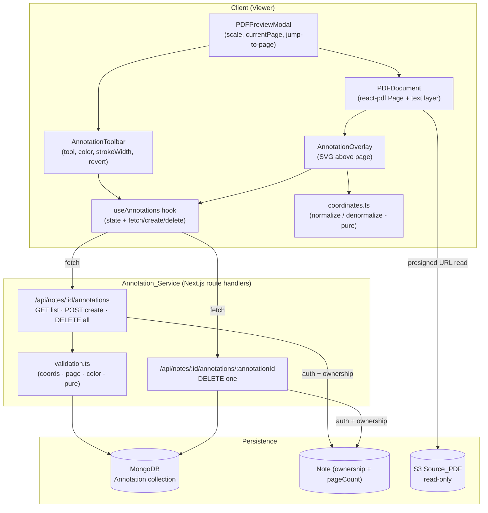

# Design Document: PDF Annotations

## Overview

This feature adds a per-user, per-note annotation layer on top of the existing Note-Sphere PDF viewer (`components/modals/PDFPreviewModal.tsx` + `components/modals/PDFDocument.tsx`). Owners can highlight text, draw freehand scribbles in selectable colors, revert a note to its clean original state, and jump to a specific page.

The central design principle is **overlay-only persistence**: the `Source_PDF` in S3 is never modified. Annotations are stored as separate metadata documents in MongoDB (a new `Annotation` model) and re-rendered on top of the `react-pdf` page each time the `Viewer` opens. All coordinates are persisted as `Normalized_Coordinates` — fractions in `[0, 1]` relative to the *unscaled* page dimensions — so a single stored value renders correctly at every zoom level.

The design reuses the established stack and conventions exactly:

- **Route handlers** under `app/api/notes/[id]/annotations/...`, mirroring the auth + `connectDB()` + ownership pattern already used in `app/api/notes/[id]/route.ts`.
- **Auth.js v5** `auth()` for authentication and the same `session.user.id` ownership check.
- **Mongoose/MongoDB** for the annotation metadata, following the `INote`/`ILabel` schema style.
- **react-pdf / pdfjs-dist** for rendering; the overlay is a sibling element layered above the existing `<Page>` canvas + text layer.

### Research Notes

Key findings that inform the design, grounded in the existing code and libraries:

- **Unscaled page dimensions are required for zoom independence.** `react-pdf`'s `<Page>` exposes an `onRenderSuccess` callback whose page proxy provides the intrinsic (scale-1) viewport via `page.getViewport({ scale: 1 })` → `{ width, height }`. Dividing rendered pixel coordinates by `unscaledWidth * scale` yields a normalized value that is stable across the modal's existing `scale` state (`0.6`–`2.5`, stepped by `0.2` in `PDFPreviewModal`). Content was rephrased for compliance with licensing restrictions. ([react-pdf Page docs](https://github.com/wojtekmaj/react-pdf#page), [pdfjs getViewport](https://mozilla.github.io/pdf.js/api/draft/module-pdfjsLib-PDFPageProxy.html))
- **Text-selection highlights map cleanly to rectangles.** The DOM `Selection` API's `range.getClientRects()` returns one `DOMRect` per line box of a multi-line selection, which is exactly the "one or more rectangular regions covering every selected line" shape required by Requirement 1.1. Each rect is converted to page-relative pixels (subtracting the page container's `getBoundingClientRect()`) and then normalized. react-pdf renders the pdfjs text layer when `renderTextLayer={true}` (already enabled in `PDFDocument.tsx`), so selectable text spans are present.
- **Freehand capture uses Pointer Events.** A transparent SVG/overlay above the page captures `pointerdown`/`pointermove`/`pointerup`. While drawing mode is active, the overlay sets `pointer-events: auto` and the underlying text layer is made non-selectable (`user-select: none`), satisfying Requirement 4.4.
- **No test tooling exists yet.** `package.json` has only `next`, `eslint`, and app dependencies. The design introduces **Vitest** (Vite-native, works with the existing TS setup) as the test runner and **fast-check** as the property-based testing library for the round-trip and validation properties in Requirement 7.

## Architecture



### Request lifecycle

1. **Open note** → `PDFPreviewModal` loads the presigned URL (existing flow) and `useAnnotations` issues `GET /api/notes/:id/annotations`. Records are grouped by `pageNumber` client-side.
2. **Render page** → `PDFDocument` renders the `<Page>`; `onRenderSuccess` reports the unscaled dimensions to the overlay. The overlay renders only annotations whose `pageNumber === currentPage`, mapping normalized coordinates to pixels using the current `scale`.
3. **Create** → text selection (highlight) or pointer stroke (scribble) produces normalized coordinates → optimistic render → `POST` → on success the record is reconciled with its server `_id`; on failure the optimistic annotation is handled per the error rules below.
4. **Revert** → confirmation prompt → `DELETE /api/notes/:id/annotations` (clear-all) → overlay clears.

### Layering model

The overlay is absolutely positioned over the page, matching the rendered page box (`unscaledWidth * scale` × `unscaledHeight * scale`). It sits above the canvas and text layer via `z-index`. When the active tool is `none`, the overlay is `pointer-events: none` so normal text selection and scrolling work. When a drawing/highlight tool is active, it captures pointer/selection events as needed.

## Components and Interfaces

### Server: Annotation_Service

All handlers follow the exact pattern in `app/api/notes/[id]/route.ts`: `await auth()` → 401 if no `session.user.id` → `await params` (Next.js 16) → `connectDB()` → **ownership check by loading the parent `Note` scoped to `{ _id: id, userId: session.user.id }`** → operate only on annotations matching both `noteId` and `userId`.

#### `app/api/notes/[id]/annotations/route.ts`

```ts
type RouteParams = { params: Promise<{ id: string }> };

// GET /api/notes/:id/annotations
// -> { annotations: AnnotationDTO[] }  (empty array when none; capped at 5000)
export async function GET(_req: NextRequest, { params }: RouteParams): Promise<NextResponse>;

// POST /api/notes/:id/annotations
// body: CreateAnnotationInput
// -> 201 { annotation: AnnotationDTO } | 400 validation error | 401 | 404 note-not-owned
export async function POST(req: NextRequest, { params }: RouteParams): Promise<NextResponse>;

// DELETE /api/notes/:id/annotations   (revert / clear-all)
// -> 200 { deletedCount: number }   (success + deletedCount 0 when none)
export async function DELETE(_req: NextRequest, { params }: RouteParams): Promise<NextResponse>;
```

#### `app/api/notes/[id]/annotations/[annotationId]/route.ts`

```ts
type RouteParams = { params: Promise<{ id: string; annotationId: string }> };

// DELETE /api/notes/:id/annotations/:annotationId   (delete single)
// -> 200 { message } | 401 | 404 (not found or not owned)
export async function DELETE(_req: NextRequest, { params }: RouteParams): Promise<NextResponse>;
```

**Ownership resolution (shared helper).** Each handler first verifies note ownership:

```ts
const note = await Note.findOne({ _id: id, userId: session.user.id });
if (!note) return NextResponse.json({ error: "Note not found" }, { status: 404 });
```

This single check satisfies Requirement 2.4/2.6: a non-owner (or unauthenticated caller, caught earlier at 401) can never read, create, or delete another user's annotations, because both the `Note` lookup and every `Annotation` query are scoped to `session.user.id`. The `note.pageCount` value is used to validate `pageNumber` on create (Requirement 7.4).

#### Server validation module — `lib/annotations/validation.ts` (pure)

```ts
export const PALETTE = [
  "#fde047", "#86efac", "#93c5fd",
  "#f9a8d4", "#fdba74", "#d8b4fe",
] as const;                        // >= 6 distinct colors (Req 6.1)
export type PaletteColor = typeof PALETTE[number];

export interface ValidationResult { ok: boolean; error?: string; }

// Validates a create request against Req 6.4/6.5 and 7.2-7.6.
export function validateAnnotationInput(
  input: unknown,
  pageCount: number
): ValidationResult;

// Individual predicates (unit-testable + used inside validateAnnotationInput):
export function isNormalized(n: unknown): boolean;      // number, 0 <= n <= 1
export function isValidPage(p: unknown, pageCount: number): boolean; // integer, 1..pageCount
export function isPaletteColor(c: unknown): c is PaletteColor;
```

### Client: Viewer integration

#### `AnnotationToolbar` (new — `components/modals/AnnotationToolbar.tsx`)

Rendered in the `PDFPreviewModal` header/controls row.

```ts
type Tool = "none" | "highlight" | "scribble";

interface AnnotationToolbarProps {
  tool: Tool;
  onToolChange: (t: Tool) => void;
  highlightColor: PaletteColor;   // active color for highlight tool
  scribbleColor: PaletteColor;    // active color for scribble tool (independent — Req 6.2)
  onColorChange: (t: Tool, c: PaletteColor) => void;
  strokeWidth: number;            // 1..20 (Req 4.1)
  onStrokeWidthChange: (w: number) => void;
  onRevert: () => void;           // opens confirmation (Req 3.4)
  totalPages: number;
  onJumpToPage: (page: number) => void;  // validated (Req 5)
}
```

- **Color palette**: renders `PALETTE` swatches; the active color is per-tool (Requirement 6.2). Defaults: `highlightColor = PALETTE[0]`, `scribbleColor = PALETTE[2]` — deterministic defaults (Requirement 6.3).
- **Jump-to-page input**: a controlled text input + submit. On submit, `parseJumpInput` (below) validates; invalid values leave the page unchanged and surface an inline error (Requirements 5.2, 5.3).
- **Revert button**: triggers a confirmation dialog; deletion only fires on confirm (Requirements 3.4, 3.6).

#### `AnnotationOverlay` (new — `components/modals/AnnotationOverlay.tsx`)

An absolutely-positioned SVG layer sized to the rendered page box, rendered as a sibling of `<Page>` inside `PDFDocument`.

```ts
interface AnnotationOverlayProps {
  annotations: AnnotationDTO[];    // already filtered to currentPage
  pageNumber: number;
  scale: number;
  unscaledWidth: number;           // from page.getViewport({ scale: 1 })
  unscaledHeight: number;
  tool: Tool;
  activeColor: PaletteColor;
  strokeWidth: number;
  onCreateHighlight: (rects: NormRect[]) => void;   // from text selection
  onCreateScribble: (points: NormPoint[]) => void;  // from pointer stroke
}
```

Rendering:
- **Highlights**: one `<rect>` per `NormRect`, positioned at `x * unscaledWidth * scale`, etc., filled with the annotation color at reduced opacity (multiply-like blend).
- **Scribbles**: a single `<path>`/`<polyline>` built from the ordered `points`, mapped to pixels the same way, `stroke-width` = the stored `strokeWidth` in CSS pixels (kept constant regardless of zoom by applying it directly, not via viewBox scaling).

Interaction:
- **Highlight capture**: on `mouseup`/selection change while `tool === "highlight"`, read `window.getSelection()`; if the range is non-empty, convert `range.getClientRects()` → page-relative pixels → `NormRect[]` via `coordinates.ts`, then call `onCreateHighlight`. If the selection is empty/collapsed, do nothing (Requirement 1.5).
- **Scribble capture**: while `tool === "scribble"`, pointer events build a live point list; on `pointerup`, if `>= 2` distinct points, call `onCreateScribble`; otherwise discard (Requirement 4.6). Text selection is suppressed during scribble mode (Requirement 4.4).

#### `useAnnotations` hook (new — `components/modals/useAnnotations.ts`)

Owns annotation state and network calls; keeps components thin.

```ts
interface UseAnnotations {
  byPage: (page: number) => AnnotationDTO[];
  loading: boolean;
  error: string | null;
  createHighlight(page: number, rects: NormRect[], color: PaletteColor): Promise<void>;
  createScribble(page: number, points: NormPoint[], color: PaletteColor, strokeWidth: number): Promise<void>;
  deleteOne(annotationId: string): Promise<void>;
  revertAll(): Promise<void>;   // clear-all after confirmation
}
function useAnnotations(noteId: string): UseAnnotations;
```

Behavior:
- Loads all records on mount (`GET`), tolerating up to 5,000 (Requirement 2.1).
- **Optimistic create**: renders immediately, then `POST`. On highlight save failure → remove the optimistic highlight and surface error (Requirement 1.6). On scribble save failure → **retain** the rendered scribble on the current page and surface error (Requirement 4.7). (This asymmetry is intentional and comes straight from the requirements.)
- `revertAll` calls the clear-all `DELETE`; on failure the local set is preserved (Requirement 3.7).

#### Coordinate module — `lib/annotations/coordinates.ts` (pure, the heart of zoom-independence)

```ts
export interface NormPoint { x: number; y: number; }               // each in [0,1]
export interface NormRect  { x: number; y: number; w: number; h: number; } // each in [0,1]

export interface PageDims { unscaledWidth: number; unscaledHeight: number; scale: number; }

// pixel (relative to page top-left, at current scale) -> normalized [0,1]
export function toNormalizedPoint(px: number, py: number, d: PageDims): NormPoint;
export function toNormalizedRect(px: number, py: number, pw: number, ph: number, d: PageDims): NormRect;

// normalized [0,1] -> pixel at current scale (inverse of the above)
export function toPixelPoint(n: NormPoint, d: PageDims): { x: number; y: number };
export function toPixelRect(n: NormRect, d: PageDims): { x: number; y: number; w: number; h: number };

// clamp helper to guarantee outputs land in [0,1] before persisting
export function clamp01(n: number): number;
```

The `toNormalized*`/`toPixel*` pairs are exact inverses (modulo floating-point), which underpins Correctness Property 2 (scale round-trip). `strokeWidth` is intentionally **not** normalized — it is a CSS-pixel value stored as-is (Requirement 4.1 defines it in pixels), so scribbles keep a constant visual thickness across zoom levels.

#### Serialization module — `lib/annotations/serialize.ts` (pure)

```ts
// Domain object <-> persisted plain JSON form used in POST body and Mongo document.
export function serializeAnnotation(a: Annotation): AnnotationDTO;
export function deserializeAnnotation(dto: AnnotationDTO): Annotation;
```

These are exact inverses for all valid annotations and back Correctness Property 1 (round-trip). Numbers pass through unchanged (no lossy formatting), preserving the count and order of coordinate points.

#### `PDFDocument` / `PDFPreviewModal` changes

- **`PDFDocument`**: add `onRenderSuccess` on `<Page>` to capture `page.getViewport({ scale: 1 })` and lift `{ unscaledWidth, unscaledHeight }` to the modal; render `<AnnotationOverlay>` as a positioned sibling of `<Page>` inside a `position: relative` wrapper; forward `tool`, `activeColor`, `strokeWidth`, and the create callbacks.
- **`PDFPreviewModal`**: hold new state (`tool`, `highlightColor`, `scribbleColor`, `strokeWidth`); mount `AnnotationToolbar`; wire the existing `currentPage`/`setCurrentPage` and `scale` state to jump-to-page and overlay scaling. The existing page nav and zoom controls are unchanged; jump-to-page reuses `setCurrentPage`.

### Jump-to-page parsing — `lib/annotations/pageInput.ts` (pure)

```ts
export type JumpResult =
  | { ok: true; page: number }
  | { ok: false; reason: "not-integer" | "out-of-range" };

// Req 5.1-5.3: accept only whole numbers in [1, totalPages]; classify failures.
export function parseJumpInput(raw: string, totalPages: number): JumpResult;
```

## Data Models

### New Mongoose model — `models/Annotation.ts`

Follows the `INote`/`ILabel` conventions (typed `Document` interface, indexed `userId`, `timestamps: true`, `mongoose.models.X || mongoose.model(...)` guard).

```ts
import mongoose, { Document, Schema, Model } from "mongoose";
import { PALETTE } from "@/lib/annotations/validation";

export type AnnotationType = "highlight" | "scribble";

export interface INormRect  { x: number; y: number; w: number; h: number; }
export interface INormPoint { x: number; y: number; }

export interface IAnnotation extends Document {
  _id: mongoose.Types.ObjectId;
  userId: mongoose.Types.ObjectId;   // Owner (Req 1.3, 2.4)
  noteId: mongoose.Types.ObjectId;   // parent note (Req 1.3)
  type: AnnotationType;              // "highlight" | "scribble"
  pageNumber: number;               // integer >= 1, <= note.pageCount (Req 7.4)
  color: string;                    // one of PALETTE (Req 6.4/6.5)
  rects: INormRect[];               // for highlights: >= 1 rect; each field in [0,1]
  points: INormPoint[];             // for scribbles: 2..10000 points; each field in [0,1]
  strokeWidth?: number;             // scribbles only: 1..20 px (Req 4.1)
  createdAt: Date;
  updatedAt: Date;
}
```

Schema definition:

```ts
const NormRectSchema = new Schema<INormRect>({
  x: { type: Number, required: true, min: 0, max: 1 },
  y: { type: Number, required: true, min: 0, max: 1 },
  w: { type: Number, required: true, min: 0, max: 1 },
  h: { type: Number, required: true, min: 0, max: 1 },
}, { _id: false });

const NormPointSchema = new Schema<INormPoint>({
  x: { type: Number, required: true, min: 0, max: 1 },
  y: { type: Number, required: true, min: 0, max: 1 },
}, { _id: false });

const AnnotationSchema = new Schema<IAnnotation>({
  userId: { type: Schema.Types.ObjectId, ref: "User", required: true, index: true },
  noteId: { type: Schema.Types.ObjectId, ref: "Note", required: true, index: true },
  type:   { type: String, enum: ["highlight", "scribble"], required: true },
  pageNumber: {
    type: Number, required: true, min: 1,
    validate: { validator: Number.isInteger, message: "pageNumber must be a whole number" }, // Req 7.6
  },
  color:  { type: String, required: true, enum: PALETTE },   // Req 6.4/6.5
  rects:  { type: [NormRectSchema],  default: [] },
  points: { type: [NormPointSchema], default: [] },
  strokeWidth: { type: Number, min: 1, max: 20 },            // Req 4.1
}, { timestamps: true });

// Primary access pattern: all annotations for one note owned by one user, by page.
AnnotationSchema.index({ noteId: 1, userId: 1, pageNumber: 1 });
```

The Mongoose `min: 0, max: 1` validators enforce the coordinate bounds (Requirement 7.2/7.3) as a defense-in-depth layer behind the explicit `validation.ts` checks, and the `enum: PALETTE` enforces color validity (Requirement 6.5). The `Source_PDF` (`note.s3Key` in S3) is referenced only via read (presigned URL) and never written by this feature (Requirement 3.3).

### DTO / wire format (`AnnotationDTO`)

The POST body and GET response items share one plain-JSON shape:

```ts
interface CreateAnnotationInput {
  type: "highlight" | "scribble";
  pageNumber: number;
  color: string;
  rects?: { x: number; y: number; w: number; h: number }[];  // required when type === "highlight"
  points?: { x: number; y: number }[];                       // required when type === "scribble"
  strokeWidth?: number;                                       // required when type === "scribble"
}

interface AnnotationDTO extends CreateAnnotationInput {
  _id: string;
  noteId: string;
  createdAt: string;
  updatedAt: string;
}
```

### Relationship to existing models

- **`Note.pageCount`** already exists (`INote.pageCount?: number`). The create handler reads it to bound `pageNumber` (Requirement 7.4). If `pageCount` is null/absent, the handler falls back to validating only `pageNumber >= 1` and relies on the client (which knows `numPages` from `onDocumentLoadSuccess`) for the upper bound.
- Deleting a `Note` (existing `DELETE /api/notes/:id`) should also clear its annotations; the design adds an `Annotation.deleteMany({ noteId, userId })` call to that handler as a cleanup step (documented here; a small addition to the existing route).


## Correctness Properties

*A property is a characteristic or behavior that should hold true across all valid executions of a system — essentially, a formal statement about what the system should do. Properties serve as the bridge between human-readable specifications and machine-verifiable correctness guarantees.*

The following properties were derived from the acceptance-criteria prework. Redundant criteria were consolidated: the storage-fidelity criteria (1.2, 4.2, 4.5) collapse into the round-trip property; the positional-rendering criteria (2.2, 2.3) collapse into the coordinate-mapping property; and the validation criteria (6.4, 6.5, 7.3–7.6) collapse into a single validation-soundness property.

### Property 1: Serialization round-trip preserves annotations

*For any* valid `Annotation` (highlight or scribble), deserializing its serialized form SHALL produce an annotation whose `type`, `pageNumber`, and `color` are exactly equal to the original, and whose normalized coordinates (every `rects` field and every `points` field) each match the corresponding original value within an absolute tolerance of `0.000001`, preserving both the count and the order of all coordinate points.

**Validates: Requirements 7.1, 1.2, 4.2, 4.5**

### Property 2: Coordinate mapping is an exact, scale-independent inverse

*For any* pixel coordinate on a page with given unscaled dimensions, normalizing it and then converting back to pixels at *any* scale SHALL reproduce the location scaled purely by the ratio of scales (within a 1-pixel tolerance); equivalently, `toNormalized` is invariant to the current scale and `toPixel` is its exact inverse at a fixed scale.

**Validates: Requirements 2.2, 2.3, 4.5**

### Property 3: Normalization always yields in-range coordinates

*For any* pixel coordinate within a rendered page's bounds, the normalized result SHALL have every component greater than or equal to `0` and less than or equal to `1`.

**Validates: Requirements 7.2**

### Property 4: Input validation soundness

*For any* create request, `validateAnnotationInput` SHALL reject the request (and the service SHALL persist no `Annotation_Record`) if it contains any coordinate that is absent, not a number, less than `0`, or greater than `1`; a `pageNumber` that is not a whole number or is outside `[1, pageCount]`; or a `color` that is not one of the predefined `Color_Palette` values — and SHALL accept the request only when the type, page number, color, and all coordinates are valid.

**Validates: Requirements 7.3, 7.4, 7.5, 7.6, 6.4, 6.5**

### Property 5: Ownership scoping invariant

*For any* authenticated owner and note, every created `Annotation_Record` SHALL carry that owner's `userId` and the requested `noteId`, and every read or delete operation SHALL affect only records whose `userId` matches the authenticated owner — never returning or mutating a record belonging to another user.

**Validates: Requirements 1.3, 2.1, 2.4**

### Property 6: Clear-all removes exactly the note's annotations and is idempotent

*For any* set of stored annotations for a note, performing the revert/clear-all operation SHALL result in zero remaining `Annotation_Records` for that note and owner and SHALL return a success result, including the case where the note already had none (applying it again changes nothing).

**Validates: Requirements 3.1, 3.5**

### Property 7: Degenerate inputs are no-ops

*For any* highlight action with an empty or whitespace-only/collapsed selection, and *for any* completed stroke reducing to fewer than 2 distinct points, the system SHALL take no persistence action and SHALL leave the existing annotation set unchanged.

**Validates: Requirements 1.5, 4.6**

### Property 8: Jump-to-page input is classified totally and correctly

*For any* input string and total page count, `parseJumpInput` SHALL return `{ ok: true, page }` exactly when the input is a whole number within `[1, totalPages]`, `{ ok: false, reason: "out-of-range" }` for any whole number outside that range, and `{ ok: false, reason: "not-integer" }` for any input that is not a whole number (including decimals, non-numeric characters, empty, or whitespace).

**Validates: Requirements 5.1, 5.2, 5.3**

### Property 9: Per-page rendering selects exactly that page's annotations

*For any* set of annotations and any page number, the overlay's page selection SHALL return exactly the annotations whose `pageNumber` equals that page — no annotations from other pages and none omitted.

**Validates: Requirements 5.4**

### Property 10: Per-tool active color independence

*For any* sequence of per-tool color selections, each tool's active color SHALL equal the most recent color selected for that tool, and selecting a color for one tool SHALL leave every other tool's active color unchanged.

**Validates: Requirements 6.2**

### Property 11: Hit-testing correctness

*For any* `Annotation_Record` and any pointer `NormPoint`, `annotationHitByPoint` SHALL return `true` if and only if either the annotation is a highlight and the point lies inside at least one of its `rects` (point-in-rect), or the annotation is a scribble and the point lies within the stroke tolerance (`strokeWidth / 2` in normalized units plus a small fixed tolerance) of at least one of its consecutive stroke segments (point-near-segment) — and `false` otherwise.

**Validates: Requirements 9.1, 9.3, 9.4**

### Property 12: Rectangle intersection correctness

*For any* two `NormRect` values, `intersectRect` SHALL return the geometric intersection rectangle when the two rectangles overlap and an empty (zero-area) result when they are disjoint; equivalently, a point lies in the returned intersection if and only if it lies in both input rectangles.

**Validates: Requirements 8.3**

## Error Handling

Error handling follows the existing route-handler convention (`try/catch`, `console.error("[TAG]", error)`, `NextResponse.json({ error }, { status })`).

### Server (Annotation_Service)

| Condition | Status | Behavior |
| --- | --- | --- |
| No authenticated session (`!session?.user?.id`) | `401` | No DB access; no record read/created/deleted (Req 2.5). |
| Note not found or not owned (`Note.findOne({_id, userId})` null) | `404` | No annotation query runs; non-owners cannot reach another user's data (Req 2.6). |
| Invalid create input (bad coord/page/color) | `400` | `validateAnnotationInput` fails before any write; response names the offending field (Req 6.5, 7.3–7.6). Nothing persisted. |
| Create persistence failure (`save` throws) | `500` | Returns error result; no partial record. Client removes optimistic highlight (Req 1.6) / retains scribble (Req 4.7). |
| List retrieval failure | `500` | Returns error result and **no** partial set (Req 2.7). |
| Delete-one: annotation not found for `{_id, noteId, userId}` | `404` | No-op; nothing else changed. |
| Clear-all failure (`deleteMany` throws) | `500` | Error result; existing records preserved (Req 3.7). |
| Clear-all with no matching records | `200` | Success, `deletedCount: 0`, state unchanged (Req 3.5). |

### Client (Viewer)

- **Optimistic-create reconciliation** — highlights are rolled back on save failure (Req 1.6); scribbles are kept on the page on save failure (Req 4.7). Both surface a non-blocking error indication.
- **Revert confirmation** — deletion is gated behind an explicit confirm dialog; cancel performs no network call and no state change (Req 3.4, 3.6). On clear-all failure, the local set is preserved (Req 3.7).
- **Jump-to-page** — invalid input never changes the current page; an inline message distinguishes "outside valid range" (Req 5.2) from "must be a whole number" (Req 5.3).
- **Load failure** — a failed `GET` sets an error state; the PDF still renders (annotations simply absent) so viewing is never blocked.

### Data integrity

`validation.ts` runs before persistence, and the Mongoose schema (`min/max` on coordinates, `enum: PALETTE` on color, integer validator on `pageNumber`) provides a defense-in-depth second layer. The `Source_PDF` in S3 is never written by any annotation handler (Req 3.3) — the module imports no S3 write helper.

## Mobile Input & Eraser (Requirements 8-9)

This section extends the existing Viewer with reliable touch/stylus input (Requirement 8) and an `Eraser_Tool` for removing individual annotations (Requirement 9). Both build directly on the components described above rather than replacing them; the additions are grounded in the current code in `components/modals/*` and `lib/annotations/colorState.ts`.

### Touch and pointer input (Requirement 8)

**Root cause of the current mobile failure.** Two properties of the existing implementation break touch:

1. Highlight capture in `AnnotationOverlay.tsx` relies on **native text selection** (`window.getSelection()` triggered by `onMouseUp`). On touch devices a finger drag pans/zooms the page instead of selecting text, so no selection is produced and no highlight is created.
2. The overlay only sets `touch-action: none` **while the scribble tool is active** (`touchAction: tool === "scribble" ? "none" : "auto"`), and `PDFDocument.tsx` only sets `user-select: none` on the wrapper for scribble. During highlight (and the new eraser) the browser therefore keeps its default pan/pinch gestures, so drags never reach the overlay as usable input.

**Fix — unify input on Pointer Events for every interactive tool.** The design generalizes the notion of an *interactive tool* to `highlight | scribble | eraser` (all tools except `none`) and applies pointer-capture behavior uniformly (Req 8.1, 8.4):

- In `AnnotationOverlay`, compute `const interactive = tool !== "none";` and set both `touch-action: none` and `pointer-events: auto` whenever `interactive` is true (previously scribble-only). Call `e.preventDefault()` in the `pointerdown` handler for **all** interactive tools, and call `svgRef.current?.setPointerCapture(e.pointerId)` so the active pointer stream stays bound to the overlay for the duration of the gesture. While `tool === "none"`, the overlay keeps `pointer-events: none` and `touch-action: auto` so normal scrolling and pinch-zoom continue to work (Req 8.2).
- In `PDFDocument`, apply the wrapper `div`'s `userSelect: "none"` / `WebkitUserSelect: "none"` **and** `touchAction: "none"` whenever any interactive tool is active (currently gated on `tool === "scribble"` only), so the underlying text layer never hijacks a drawing/highlight/erase drag.

**Highlight via a pointer drag (replaces selection-based capture).** Highlight capture is reworked to use `Pointer_Input` so it behaves identically for mouse, touch, and stylus (Req 8.3, 8.4):

1. On `pointerdown` (tool `highlight`), record the start pixel point relative to the page box (`svgRef.current.getBoundingClientRect()`), mark drawing active, and capture the pointer.
2. On `pointermove`, track the current pixel point and render a faint **preview selection rectangle** (a low-opacity `<rect>`) spanning the start and current points, giving live feedback.
3. On `pointerup`, build the drag rectangle in page-pixel coordinates as the `min`/`max` of the start and end points (`x = min(x0,x1)`, `y = min(y0,y1)`, `w = |x1-x0|`, `h = |y1-y0|`).
   - **Zero-area drag ⇒ no-op** (Req 8.5): if `w === 0 || h === 0`, discard and leave annotations unchanged.
   - **Text-aware highlighting:** query the react-pdf text layer spans via
     `svgRef.current?.parentElement?.querySelectorAll(".react-pdf__Page__textContent span")`.
     For each span, compute its client rect relative to the page box and test intersection with the drag rectangle using `rectsIntersect` from the new `hitTest` module. For every intersecting span, convert its (clipped) client rect to a `NormRect` via `toNormalizedRect`.
   - If **at least one** span intersects, create the highlight from the collected span rects (covering the selectable text within the dragged region).
   - If **no** span intersects (e.g., an image-only region), fall back to a single `NormRect` equal to the dragged region itself (Req 8.3).
   - Call `onCreateHighlight(rects)` only when `rects.length > 0`.

The scribble path is unchanged in behavior but shares the same `preventDefault` + `setPointerCapture` treatment already present, now reached through the unified interactive-tool guard.

### Geometry helper — `lib/annotations/hitTest.ts` (pure)

A new pure module centralizes the geometry used by both text-intersection highlighting and the eraser. It operates entirely on `Normalized_Coordinates` / pixel-space `NormRect`/`NormPoint` shapes (the same numeric shapes as `coordinates.ts`) and performs no I/O, which makes it directly property-testable (Properties 11 and 12).

```ts
import type { NormPoint, NormRect } from "./coordinates";
import type { AnnotationDTO } from "./serialize";

// True when two rectangles overlap (touching edges count as intersecting only
// when the overlap has positive area).
export function rectsIntersect(a: NormRect, b: NormRect): boolean;

// Geometric intersection of two rectangles; returns a zero-area rect
// (w === 0 || h === 0) when they are disjoint (Property 12).
export function intersectRect(a: NormRect, b: NormRect): NormRect;

// True when point p lies within rect r (inclusive of edges).
export function pointInRect(p: NormPoint, r: NormRect): boolean;

// True when point p lies within `tolerance` of segment a→b (distance from a
// point to a line segment, clamped to the segment endpoints).
export function pointNearSegment(
  p: NormPoint,
  a: NormPoint,
  b: NormPoint,
  tolerance: number
): boolean;

// Tool-level hit test used by the eraser:
//  - highlight: p inside ANY of the annotation's rects
//  - scribble:  p within tolerance of ANY consecutive stroke segment,
//               where tolerance = (strokeWidth / 2) normalized + a small epsilon
export function annotationHitByPoint(
  annotation: AnnotationDTO,
  point: NormPoint,
  tolerance: number
): boolean;
```

### Eraser tool (Requirement 9)

**Tool model.** Extend the `Tool` union in `lib/annotations/colorState.ts` to include the eraser:

```ts
export type Tool = "none" | "highlight" | "scribble" | "eraser";
```

`ColorTool` (the color-bearing tools) is unchanged, so `activeColorFor` still resolves `eraser` through its existing fallback to the highlight color. That color is never used by the eraser, satisfying the requirement that the palette does not affect eraser behavior (Req 9.5).

**Toolbar.** `AnnotationToolbar` gains an eraser button alongside the existing none/highlight/scribble buttons, using the `lucide-react` `Eraser` icon, wired to `onToolChange("eraser")` with the same `aria-pressed` pattern as the other tool buttons.

**Overlay behavior.** `AnnotationOverlay` gains an optional prop:

```ts
onErase?: (annotationId: string) => void;
```

When `tool === "eraser"`:
- On `pointerdown` and on each `pointermove` (while the pointer is captured), convert the pointer position to a `NormPoint` (reusing the existing `pointFromEvent` helper) and hit-test every annotation on the current page via `annotationHitByPoint`:
  - highlights → `pointInRect` against each rect;
  - scribbles → `pointNearSegment` against each consecutive segment, with tolerance `strokeWidth / 2` converted to normalized units plus a small epsilon (Req 9.1, 9.3).
- For each hit annotation that has a **real** server `_id` (not a `temp-…` optimistic id), call `onErase(_id)`.
- Maintain a `Set<string>` of ids already erased during the current drag and skip ids already in the set, so a single drag never issues two deletes for the same annotation.
- When no annotation is hit at the pointer location, take no action (Req 9.4).

**Wiring.** `PDFPreviewModal` passes `onErase={annotations.deleteOne}` down through `PDFDocument` to the overlay. The existing `deleteOne(annotationId)` in `useAnnotations` already performs optimistic removal with restore-on-failure, which directly satisfies immediate visual removal (Req 9.2) and error recovery (Req 9.6). `PDFDocument` forwards the new `onErase` prop and keeps the overlay enabled for the eraser tool — `annotationsEnabled` is already `true` because the create handlers and `activeColor` are always supplied by the modal, so no gating change is required beyond threading the prop.

Because the eraser deletes only the specific annotations whose ids are returned by the hit test, all other records remain untouched (Req 9.3).

## Testing Strategy

### Tooling

The project has no test runner yet, so this feature introduces:

- **Vitest** — test runner (integrates with the existing TypeScript/ESM setup; run single-shot via `vitest --run`, not watch mode).
- **fast-check** — property-based testing library for JS/TS. Properties are **not** implemented from scratch; each correctness property maps to a single fast-check property test configured for a **minimum of 100 iterations** (`{ numRuns: 100 }`).
- **@testing-library/react** — for component/interaction (example) tests of the toolbar and overlay.

### Dual approach

- **Property tests** verify the universal properties above (pure logic in `lib/annotations/*` and the ownership/validation behavior of the handlers with a mocked Mongoose layer).
- **Unit / component / integration tests** cover specific examples, edge cases, and error branches identified in the prework as non-property criteria.

### Property-based tests (one per correctness property)

Each test is tagged with a comment in the format:
`// Feature: pdf-annotations, Property {number}: {property_text}`

| Property | Target under test | Generators |
| --- | --- | --- |
| 1 — Round-trip | `serialize`/`deserialize` | Arbitrary valid highlight (1..N rects) and scribble (2..10000 points) annotations |
| 2 — Scale-independent inverse | `coordinates.ts` `toNormalized*`/`toPixel*` | Arbitrary pixel coords, unscaled dims, two scales in `[0.6, 2.5]` |
| 3 — Normalization in range | `toNormalizedPoint`/`toNormalizedRect` + `clamp01` | Arbitrary in-bounds pixel coords and page dims |
| 4 — Validation soundness | `validateAnnotationInput` | Arbitrary valid inputs + arbitrary invalid mutations (NaN/absent/out-of-range coords, non-integer/out-of-range pages, non-palette colors) |
| 5 — Ownership scoping | POST/GET/DELETE handlers (mocked store) | Arbitrary userIds, noteIds, and record sets |
| 6 — Clear-all completeness/idempotence | DELETE-all handler (mocked store) | Arbitrary initial record sets incl. empty |
| 7 — Degenerate no-ops | highlight/scribble create paths | Arbitrary empty/whitespace selections; strokes with <2 distinct points |
| 8 — Jump input classification | `parseJumpInput` | Arbitrary strings + arbitrary integers in/out of range, plus totalPages |
| 9 — Per-page filtering | `byPage` selector | Arbitrary annotation sets across arbitrary page numbers |
| 10 — Per-tool color independence | color-state reducer/hook logic | Arbitrary sequences of `(tool, color)` selections |
| 11 — Hit-testing correctness | `hitTest.ts` `annotationHitByPoint` (`pointInRect` / `pointNearSegment`) | Arbitrary highlight/scribble annotations + arbitrary pointer points (incl. points inside/outside rects and near/far from segments) |
| 12 — Rectangle intersection correctness | `hitTest.ts` `intersectRect` / `rectsIntersect` | Arbitrary pairs of `NormRect` (overlapping and disjoint), plus probe points to verify the "in both iff in intersection" relation |

### Unit / component / integration (example & edge tests)

- **Highlight rendering (1.1)**: simulate a text selection; assert overlay rects appear in the active color.
- **Active color applies until changed (1.4), scribble color (4.3), defaults (6.3), palette size ≥ 6 distinct (6.1)**: toolbar/state example tests.
- **Highlight save failure rollback (1.6), scribble save failure retain (4.7), clear-all failure preserve (3.7)**: mocked-failure component tests.
- **Auth guards (2.5), non-owner (2.6)**: call each handler with no session / wrong user; assert `401`/`404` and no store interaction.
- **Revert flow (3.2, 3.4, 3.6)**: confirm opens dialog, confirm clears overlay, cancel is a no-op.
- **Drawing suppresses text selection (4.4)**: assert `user-select: none` / no selection while in scribble mode.
- **S3 untouched (3.3)**: assert annotation handlers never import/call `uploadToS3`/`deleteFromS3` (integration/inspection).
- **Touch/pointer capture (8.1, 8.2, 8.4)**: component tests that dispatch `pointerdown`/`pointermove`/`pointerup` on the overlay and assert `touch-action: none` + `pointer-events: auto` while an interactive tool is active, `touch-action: auto` + `pointer-events: none` while `tool === "none"`, and that `preventDefault`/`setPointerCapture` are invoked for pointer-driven gestures.
- **Highlight drag over text vs. non-text (8.3), zero-area no-op (8.5)**: component tests with a mocked react-pdf text layer — assert span-intersection produces per-span rects, an empty region falls back to a single dragged-region rect, and a zero-area drag creates nothing.
- **Eraser behavior (9.1–9.6)**: component tests that drag the eraser over a highlight and a scribble and assert `onErase` (→ `deleteOne`) is called once per hit annotation with its real `_id`, that a drag over empty space is a no-op (9.4), that the same id is not deleted twice within one drag, that the palette selection does not change eraser behavior (9.5), and (via a mocked failing `DELETE`) that the annotation is restored on failure (9.6).
- **Latency-sensitive criteria (1.2, 2.1, 3.2, 5.1, 9.2 timing)**: covered functionally by the above; timing is validated by lightweight integration smoke checks rather than property tests.

### Review and Approval

The `requirements.md` for this spec exists and is approved. This design addresses all nine requirements and their acceptance criteria, including touch/mobile pointer input (Requirement 8) and the eraser tool (Requirement 9). If gaps are identified during review, we can return to requirements clarification before proceeding to the task list.
