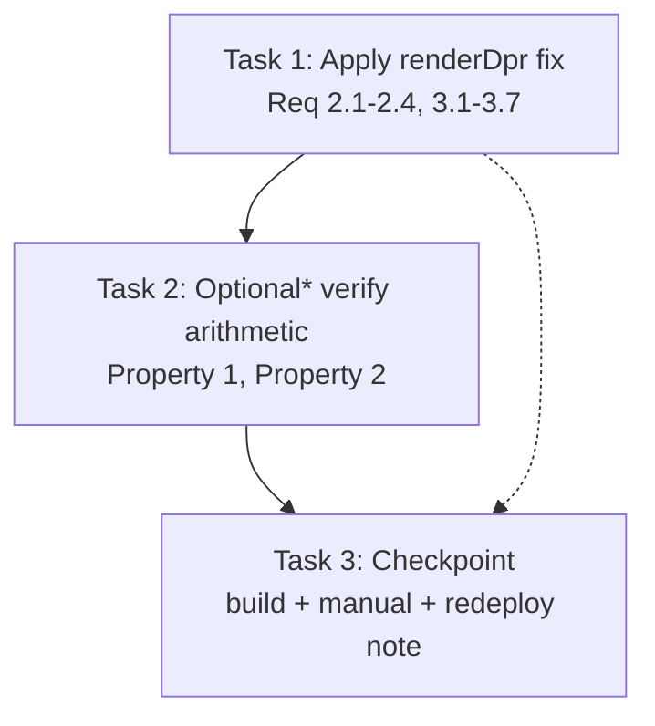

# Implementation Plan

- [ ] 1. Apply dynamic supersampling `renderDpr` in `components/modals/PDFDocument.tsx`
  - In the component body, immediately AFTER `pageWidth` and `overlayScale` are computed and BEFORE the `return`, add:
    ```tsx
    const QUALITY = 2; // supersample the page to ~2x its intrinsic point width
    const deviceDpr =
      typeof window !== "undefined" ? (window.devicePixelRatio || 1) : 2;
    const renderDpr =
      pageWidth && typeof unscaledWidth === "number" && unscaledWidth > 0
        ? Math.min(Math.max((unscaledWidth * QUALITY) / pageWidth, Math.min(deviceDpr, 2)), 4)
        : Math.min(Math.max(deviceDpr, 2), 3); // pre-measurement fallback
    ```
  - Change `<Page devicePixelRatio={...}>` from the inline `Math.min(Math.max(window.devicePixelRatio || 1, 2), 3)` expression to `devicePixelRatio={renderDpr}`.
  - Do NOT change anything else on `<Page>` (`width`, `scale`, `renderMode`, layer flags, `onRenderSuccess`, `className`) or elsewhere in the component (`overlayScale`, `hasDims`, `AnnotationOverlay`, `PDF_OPTIONS`, worker setup).
  - _Bug_Condition: isBugCondition(X) where unscaledWidth > 0 AND pageWidth > 0 AND (pageWidth × appliedDpr) < (unscaledWidth × 2)_
  - _Expected_Behavior: backing width reaches ~2x intrinsic (pageWidth × renderDpr ≥ unscaledWidth × 2) or renderDpr == 4, with renderDpr ∈ [1.5, 4]_
  - _Preservation: devicePixelRatio changes only the canvas backing store, not CSS layout — overlayScale, fit-to-width sizing, zoom label, loading, annotation actions, navigation unchanged_
  - _Requirements: 2.1, 2.2, 2.3, 2.4, 3.1, 3.2, 3.3, 3.4, 3.5, 3.6, 3.7_

- [ ] 2. Optional* verify the `renderDpr` arithmetic
  - **Property 1: Bug Condition** - Dynamic Supersampling To Intrinsic Width
  - **Property 2: Preservation** - Layout, Alignment, And Behavior Unchanged
  - *Optional: this is a rendering-quality defect against a real canvas; the only verifiable unit is the pure `renderDpr` expression. Extract/evaluate it as `computeRenderDpr(unscaledWidth, pageWidth, deviceDpr)`.
  - Buggy inputs (e.g. `612, 400, 2`): assert `pageWidth × renderDpr ≥ unscaledWidth × 2` OR `renderDpr == 4`, and `renderDpr ∈ [1.5, 4]` (Property 1).
  - Zoomed-in inputs (e.g. `612, 1000, 2`): assert `renderDpr` floors to `min(deviceDpr, 2)` (native, no drop) (Property 2).
  - Confirm `overlayScale = pageWidth / unscaledWidth` and layout inputs are independent of `renderDpr` (untouched in the diff) (Property 2).
  - _Requirements: 2.1, 2.2, 2.4, 3.1, 3.2, 3.7_

- [ ] 3. Checkpoint - build, type-check, and manual device verification
  - Run the project build / type-check; confirm no errors.
  - Manual: open a real PDF on a device (or DevTools ~400 CSS px) at 100% zoom — text is crisp; zoom in — still crisp; confirm layout and annotation alignment are unchanged.
  - Note: this is a client-render change — the improvement is visible only after a **rebuild/redeploy and a browser cache / hard refresh**.
  - Ensure all checks pass; ask the user if questions arise.

## Task Dependency Graph



- Task 1 is the single-file fix and must come first.
- Task 2 (optional) verifies the pure `renderDpr` expression against Property 1 (fix) and Property 2 (preservation).
- Task 3 is the final checkpoint (build/type-check + manual on-device verification + redeploy/cache note).
